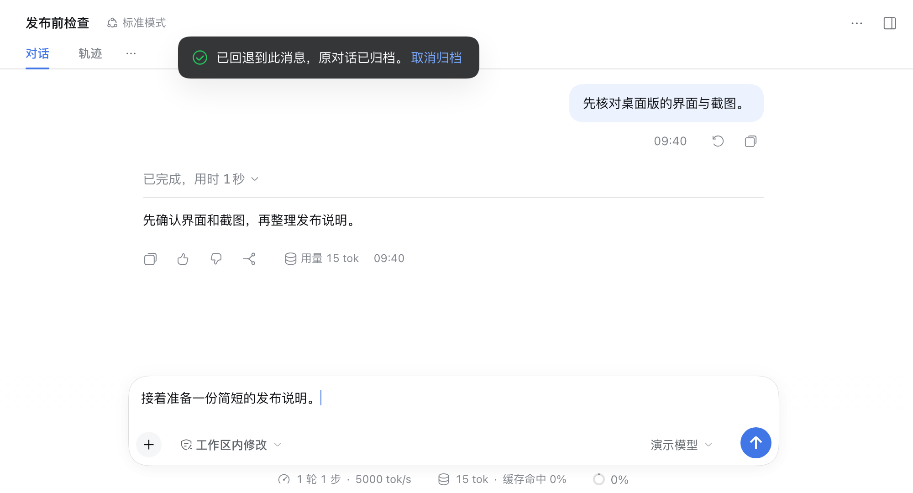
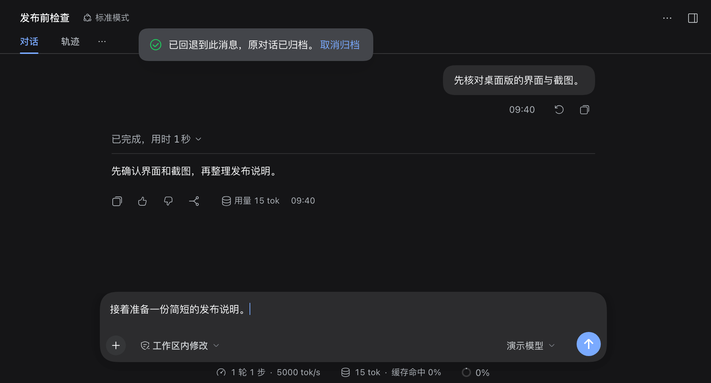
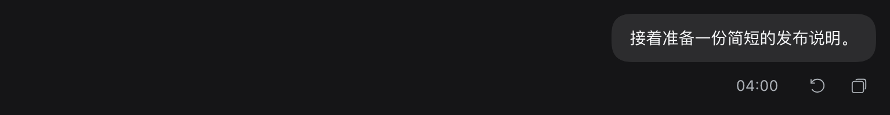

# Left Unsaid

[简体中文](README.zh.md)

Click the rewind icon beside **Copy** on any ordinary user message to branch the conversation immediately
before that turn, restore the message text and multimedia attachments into the new session’s composer,
and archive the original conversation with a one-click **Unarchive** toast.
Rewind runs immediately when idle or when only a turn is running; if subagents, background jobs,
or scheduled reminders are active, a confirmation dialog lists them before branching.
See the [product design](DESIGN.md) for expected behavior and edge cases.

`@miorin/dsh-session-rewind` supports DeepSeek Harness 0.2.2-rc.5.
To install from source, run `pnpm install` in the checkout, then select the checkout in **Plugins** > **Add plugin**.

## Screenshots and entry

Use **Rewind** next to **Copy**. After rewinding, the notice offers to unarchive the original conversation.
The screenshots show the Chinese interface.

| | Light | Dark |
| --- | --- | --- |
| Archive notice |  |  |
| Message action |  |  |

[Project documentation](docs/README.md)
