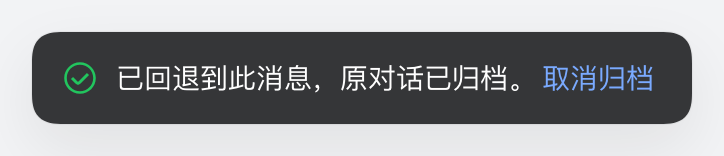
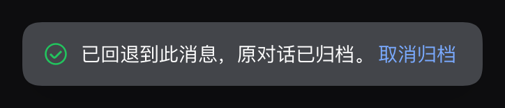

# 君子未言

[English](README.md)

在任意普通用户消息下方的 **复制** 按钮左侧点击回退图标，即可从该消息之前的对话状态创建新会话，
将该条消息的正文与多媒体附件放回新会话的输入框并归档原对话，同时弹出附带一键 **取消归档** 的轻提示。
会话空闲或仅有当前回合运行时直接执行；仅当存在运行中的子智能体、后台任务或定时提醒时，才会在创建新会话前弹出确认框。
具体边界规则与多媒体恢复机制见[设计文档](DESIGN.md)。

`@miorin/dsh-session-rewind` 支持 DeepSeek Harness 0.2.2-rc.5。
在源码目录执行 `npm ci` 完成构建后，从 **插件** > **添加插件** 选择该目录。

## 界面与入口

在「复制」旁点击「回退」。回退完成后，轻提示提供「取消归档」入口。

| | 浅色 | 深色 |
| --- | --- | --- |
| 归档提示 |  |  |
| 消息操作入口 |  |  |

[项目文档](docs/README.md)
